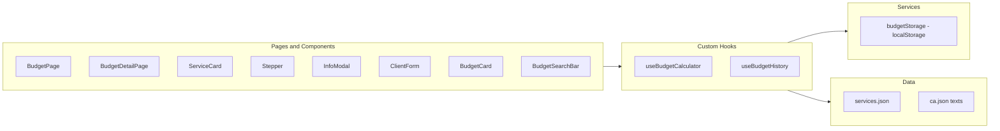

# Architecture

Layered, component-based architecture following the Single Responsibility Principle.



## Folder structure

```
src/
├── components/   # presentational UI
├── hooks/        # logic (custom hooks)
├── services/     # data access (storage)
├── utils/        # calculateTotal, formatCurrency
├── constants/    # named constants
├── data/         # services.json, ca.json
├── types/        # interfaces and types
├── pages/        # route-level views
└── tests/        # Gherkin features and specs
```

## Routes

| Path | View |
|------|------|
| `/` | Budget creation, form and history |
| `/budget/:id` | Shareable budget detail |


