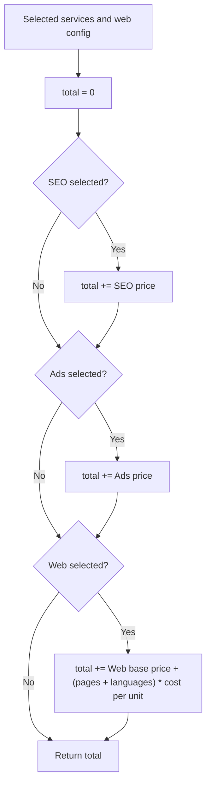

# Calculation Logic

All prices and the cost per unit come from `services.json`. No hard-coded values in the code.

## Reference examples

| Selection | Result |
|-----------|--------|
| Nothing | 0 € |
| SEO | 300 € |
| SEO + Ads | 700 € |
| Web (1 page, 3 languages) | 620 € |
| Web (4 pages, 2 languages) + SEO | 980 € |

